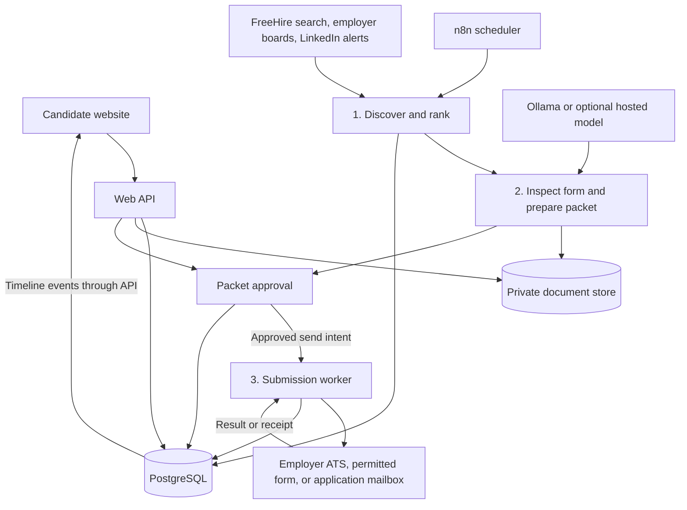

# Job application automation with n8n, LinkedIn, and FreeHire.me

The candidate uploads a CV, enters a target location and one or more job titles, then starts a campaign on a private website. The system finds openings, ranks them, creates a **job-specific CV PDF**, writes a **cover letter**, answers the employer’s **screening questions**, and submits eligible applications through supported channels. The same website shows the exact materials sent, the destination, and the employer or platform receipt.

| Level | What the system produces | When the level is complete |
| --- | --- | --- |
| 1. Find and rank | One record per vacancy, its sources, eligibility, match score, supporting CV facts, and gaps | A ranked vacancy has a known employer, destination, and reason for its rank. |
| 2. Prepare and approve | A tailored CV PDF, cover letter, typed answers, and a preview of the outgoing application | The exact packet revision has approval and all required fields have valid answers. |
| 3. Fill and submit | A completed employer application and a delivery record | The receiving system provides evidence that it accepted the application. |

## The candidate experience

The start page has three data inputs. A PDF or DOCX supplies the candidate’s experience and contact details. The location describes where the candidate wants to work. The job titles define the searches. The service owner configures n8n, models, and available connectors once. The candidate uses the website throughout.

The primary **Start and apply** action shows the scope before it starts the campaign. One approval authorizes eligible submissions for these titles, location, CV version, enabled destinations, and displayed daily limit. This is the mode for a candidate who wants to monitor progress. **Review each application** uses the same pipeline and waits for a click on each finished packet. Uploading a file alone starts no external submission. The candidate can pause either mode from the dashboard.

Both modes include the Level 2 approval screen. In automatic mode it shows which campaign rule approved the packet. When an employer needs an unknown answer, a personal signature, or an interactive verification, the site shows the specific action for that vacancy. Other eligible applications continue.

## System layout

| Component | Responsibility |
| --- | --- |
| FastAPI website and API | Serve authenticated pages, accept the upload, show PDF previews, record approvals and corrections, and stream status updates. Server-rendered pages with HTMX are sufficient for a personal deployment. |
| n8n | Schedule source polls, normalize listings, trigger matching and preparation, and wake workers for due tasks. Workflows pass record IDs. PostgreSQL holds durable job state. |
| Preparation worker | Parse the master CV, extract form requirements, call the model, validate claims, and render PDF files. It can read evidence and write drafts. |
| Submission worker | Load an approved packet, select a configured destination adapter, fill fields, attach the correct files, perform the final send, and reconcile the result. Only this worker holds submission credentials. |
| PostgreSQL and private file storage | Store candidates, vacancies, decisions, send attempts, and events in PostgreSQL. Store original CVs, generated documents, and receipt files under opaque IDs on a private volume. |

The web API writes a campaign and its initial discovery task in one transaction. An n8n **Schedule Trigger** claims due tasks. Source sub-workflows use **HTTP Request** or a mail trigger, normalize each listing, and upsert it with the **Postgres** node. A matched vacancy queues preparation. The approval transaction queues dispatch. A separate reconciliation workflow checks uncertain sends and matches incoming acknowledgements. Work can resume after a restart from these records without replaying the entire campaign.

## Level 1. Find vacancies, remove duplicates, and rank them

**Build the candidate profile once.** Extract text from the CV and use OCR for scanned pages. Save the original and its SHA-256 digest. Give each employment period, qualification, skill, project, and achievement a fact ID with a page or paragraph reference. Keep contact values available for local form filling. Low-confidence facts stay out of generated claims until corrected. A target location such as Istanbul supplies a search filter. Work authorization requires separate evidence.

**Start discovery from the three inputs.** Run an initial search immediately and repeat on a schedule, for example hourly. Issue one search per target title and retain the original location wording. Include a remote job when the posting permits work from the target location. The website shows the last successful poll and any connection required for each source.

| Source | n8n intake |
| --- | --- |
| FreeHire.me | Use `GET https://freehire.me/api/v1/agent/jobs/search` with `q`, `description_format=text`, `sort=created_at`, `limit`, and `offset`. Add supported location filters such as `countries=TR` where appropriate. Personal catalogue reads are keyless. Store `public_slug`, full description, employer, and the original posting destination from the detail record. [FreeHire search API](https://github.com/strelov1/freehire/blob/7178481ca815e31cb9bbf7826e37023b1ee6b82e/docs/API.md#search) |
| Employer boards | Poll configured Greenhouse boards and Lever sites. A recognized employer link from another source can resolve to the same posting. The deployment maintains board identifiers, region, allowed hosts, and read/write capabilities for each tenant. [Greenhouse job listings](https://github.com/grnhse/greenhouse-api-docs/blob/fab606ff3ff05c832e9cf6ba0e077d752d2e9d14/source/includes/job-board/_jobs.md) · [Lever postings API](https://github.com/lever/postings-api) |
| LinkedIn | Ingest job-alert emails from a connected candidate mailbox, or use an authorized partner feed when available. Split a digest into individual vacancies and follow the advertised application route. FreeHire and employer discovery can start while the mailbox is disconnected. The built-in n8n LinkedIn node provides post creation. [n8n LinkedIn node](https://github.com/n8n-io/n8n-docs/blob/main/docs/integrations/builtin/app-nodes/n8n-nodes-base.linkedin.md) · [LinkedIn Talent Solutions](https://learn.microsoft.com/en-us/linkedin/talent/) |

**Deduplicate before preparing documents.** First upsert the source identity, such as a FreeHire slug or LinkedIn job ID. Then resolve it to a canonical vacancy using the employer/ATS tenant and requisition ID, or a verified canonical employer posting URL. Keep each discovery source as an alias. Similar titles at the same company can refer to different teams. Flag uncertain matches and hold competing submissions until the identity is resolved.

**Rank with evidence.** Check known location and mandatory eligibility constraints before scoring. A sample policy assigns 50 points to required skills, 20 to preferred skills, 20 to title fit, and 10 to location or work mode. Count distinct requirements backed by CV facts and normalize over applicable categories. A posting with both required skills, none of its preferred skills, and full title and location fit scores **80/100**. Store the breakdown and gaps. As an initial policy, prepare matches scoring at least 75 with sufficient evidence. A compulsory question about an unknown work permit goes to the attention queue regardless of score. Scores and limits are deployment defaults the candidate can inspect.

## Level 2. Generate the application and approve its contents

1. **Inspect the destination.** Resolve the actual employer, requisition, form language, submission channel, document slots, accepted file types, and required questions. Save a versioned form description with field IDs, types, answer options, and conditional branches. Use the documented API or a permitted read of the employer’s form. If a question appears only after an earlier answer, include that branch before final approval. When the site permits only candidate inspection, prepare the documents and expose them in the handoff screen while the form is awaiting inspection.
2. **Produce the job-specific CV PDF.** Select relevant facts from the master CV and link each proposed bullet to its evidence. Reorder projects and skills for the vacancy and use the posting’s terminology where the source facts support it. Preserve employer names, historical job titles, dates, degrees, and metrics. A versioned HTML template and WeasyPrint render a selectable-text PDF. Extract text back from the PDF to check contact details, dates, and claims. Check layout, Unicode glyphs, and attachment-size limits. Save the PDF bytes and their digest under this vacancy’s packet revision. The uploaded master remains available for future vacancies.
3. **Write the cover letter.** Generate a short letter for the employer and role using two or three relevant facts. Store its text and rendered file. The packet preview identifies the delivery format for that employer. This can be a dedicated attachment, text in a supported cover-letter field, or the body of an expressly accepted email application. When a form has no letter slot, the draft stays available in the dashboard and the preview identifies the files and fields the employer will receive.
4. **Draft and validate screening answers.** Map each real question to its field ID. Copy contact details from the verified profile. Ground experience answers in CV facts and fit choices to the employer’s offered options. Check dates, lengths, numerical units, and conditional requirements. Leave optional personal disclosures blank unless the candidate has supplied an applicable answer. A required unknown creates a focused request such as “Do you currently have authorization to work in Germany?” The candidate may save the answer for the same country and purpose. Declarations that require personal assent go to the candidate.
5. **Freeze and approve a revision.** On one screen show the original posting, destination, score and gaps, downloadable tailored CV, letter, exact field values, unanswered questions, and the files that will actually be sent. The candidate can edit, approve, skip, or pause. Bind approval to the CV and packet versions, file digests, answers, destination, form schema, and policy version. A material change creates a new revision and runs the approval decision again.

**Automatic approval** is a deterministic policy check. It requires an active campaign authorization, a score in scope, an open vacancy, verified required answers, a supported write route, a valid packet, and remaining capacity. A deployment might start with three applications per candidate per day. A human-only question or changed consent text goes to the review screen. The match model has no permission to approve a packet or dispatch it.

Use Ollama locally for extraction, matching suggestions, and drafting. Require structured output with evidence IDs and reject invented qualifications. Inject contact details during local rendering. An optional hosted model can implement the same interface for candidates who enable it. Send minimized text, enforce a spending limit, and keep the local path available on quota failure. Self-hosting on existing hardware avoids a required model subscription. Hardware, electricity, hosting, and optional commercial services have separate costs.

## Level 3. Fill the form, submit, and verify delivery

Resolve capabilities for the **destination and employer tenant**. A vacancy discovered on LinkedIn or FreeHire can lead to an employer integration that supports unattended submission. The connector registry records the authorized operations, tenant credential or candidate connection, supported fields and attachments, form revision, and required success evidence. Enable automatic sending only for a route that supports the actual posting and packet.

| Destination | How the worker performs a real application |
| --- | --- |
| Greenhouse employer integration | Read the job with `questions=true`. Validate the active questions, options, attachments, and consent requirements locally. A tenant that has authorized the integration can supply its Job Board API key for `POST /v1/boards/{board_token}/jobs/{id}`. Map the approved CV, cover letter, and question fields into the request. Use the external job-post ID. Public board reads alone grant discovery access. [Greenhouse application contract](https://github.com/grnhse/greenhouse-api-docs/blob/fab606ff3ff05c832e9cf6ba0e077d752d2e9d14/source/includes/job-board/_applications.md) |
| Lever employer integration | A participating employer supplies its own application API key. Send the CV using multipart form data to that tenant’s `POST /v0/postings/{site}/{posting_id}`. Confirm required fields from the employer’s form configuration because the Postings API omits custom questions. Select another permitted route when required questions exceed its field set. Lever documents a successful response with `ok: true` and `applicationId`. Store the returned reference and redact the credential from request logs. [Lever application contract](https://github.com/lever/postings-api/blob/f61aac5831a193bc66e1183c3ad102739dfd9f56/README.md#apply-to-a-job-posting) |
| FreeHire.me | Recheck `GET /api/v1/jobs/{slug}` and `closed_at`. For external vacancies resolve the original destination. For a `direct_apply` vacancy the documented form uses `/jobs/{slug}/direct-apply` under `/api/v1`. Delivery requires a verified candidate email and a signed-in browser session. The form accepts the uploaded profile résumé or a vacancy-specific FreeHire CV ID. Use a permitted candidate flow only when it can send the approved document. Otherwise show the first-party form and explain the attachment or account action needed. The documented send acknowledgement is HTTP 201 with `data.sent = true`. The separate `POST /jobs/{slug}/apply` marks a tracking board. Hosted background auto-apply is a Pro feature. [FreeHire OpenAPI contract](https://github.com/strelov1/freehire/blob/7178481ca815e31cb9bbf7826e37023b1ee6b82e/openapi/api.openapi.json) · [Free and Pro features](https://github.com/strelov1/freehire#free-and-pro) |
| Permitted employer web form | Use a tested Playwright adapter for that site where the employer/platform permits automated completion and submission. Fill controls by their form IDs or accessible labels. Read the values back, validate conditional pages, attach the approved files, and execute the final submit once. Capture the explicit confirmation for this vacancy. A login, MFA prompt, CAPTCHA, changed form, or personal attestation pauses the attempt with a resume action. |
| Application email | When the posting expressly accepts applications by email, send the approved packet to its specified address from an authorized sender. Record the message ID. Mail-server acceptance shows **Sent, awaiting acknowledgement**. Match an employer confirmation to the application before displaying confirmed receipt. |
| LinkedIn Easy Apply or another unsupported destination | Use an approved candidate submission integration only within its granted scope. For ordinary Easy Apply, the dashboard provides the vacancy link, tailored PDF, letter, and copyable answers for the candidate’s own session. Record a manual completion and its evidence separately. External employer links go through the same adapter resolver as every other vacancy. [LinkedIn User Agreement](https://www.linkedin.com/legal/user-agreement) |

An individual applicant can start free catalogue searches immediately. For example, a personal deployment with a connected sender can submit a vacancy that explicitly accepts email applications using only the candidate’s three inputs and start authorization. The same deployment can discover a Greenhouse vacancy whose employer grants public read access and show it for handoff. Display the counts for **Can submit automatically**, **Needs account connection**, and **Needs candidate action** as soon as the destination is known.

### Dispatch and recovery

1. In one database transaction, record the approval and create a send intent for the candidate and canonical vacancy. The worker claims it, reserves budget and daily capacity, and records a durable attempt **before** contacting the destination.
2. Recheck campaign pause, vacancy status, destination, current form, approved revision, and attachment hashes immediately before the send. Form changes invalidate the affected approval. Select one employer-accepted route per application.
3. Use a stable idempotency key when supported. Persist a positive acknowledgement, provider reference when available, time, channel, and packet digest. A queued response stays pending. The job timeline distinguishes an ATS receipt, an email acknowledgement, and a candidate-reported result.
4. A known refusal such as a documented rate limit can be retried after the required delay. A timeout **after send**, a lost response, or a worker crash during dispatch moves the application to **Checking delivery**. Reconcile by provider reference, supported status lookup, account history, or matching confirmation email. Block repeat sends and alternate channels while delivery is uncertain. A candidate can resolve a case when the provider offers no reliable lookup.

## The tracking website

The normal timeline is **Discovered → Matched → Preparing → Ready for approval → Approved → Queued → Sending → Confirmed**. An attention item records both its reason and the stage to resume. A missing answer reopens preparation. A lost acknowledgement goes to delivery reconciliation. Pausing a campaign leaves incoming receipts visible for sends already in flight.

| Screen | What the candidate sees and can do |
| --- | --- |
| Campaign | Uploaded CV version, location, titles, active application scope, daily limit, connected sources, and pause/resume. A new master CV triggers fresh assessments and approvals for affected unsent packets. |
| Dashboard | Counts for discovered, matched, preparing, ready for approval, queued, checking delivery, confirmed, and needs action. Filter by source, employer, date, or score. Open an application directly from any count. |
| Application detail and approval | Job description and source aliases, match evidence, PDF preview and download, cover-letter preview, form questions and answers, destination, send mode, packet revision, and decision controls. |
| Needs action | One actionable reason per blocker, such as a missing answer, expired connection, required CAPTCHA, or unsupported attachment. Save an answer or complete the first-party step and resume from the affected stage. |
| History | Chronological events, attempt times, receiver reference, actual attachments, and follow-up dates. Interview, rejection, offer, and withdrawal are recruitment outcomes recorded from linked evidence or candidate input. |

The website reads PostgreSQL and streams committed events using Server-Sent Events. On reconnect it requests events after the last event ID and refreshes the current state. For example, `POST /api/campaigns` accepts the three inputs and the start action. `GET /api/applications/{id}` returns the packet and timeline. `POST /api/applications/{id}/decisions` requires the expected revision. `POST /api/campaigns/{id}/pause` takes effect for sends that have not begun. All of these are application-owned routes.

## Persistence, privacy, and operation

| Durable record | Invariant |
| --- | --- |
| Candidate, CV version, facts, scoped answers, campaign authorization | Each generated claim identifies the source version. Approval records identify the person or standing policy that authorized the send. |
| Vacancy, source aliases, match assessment | A source/provider ID is unique within its source. A candidate has at most one application record per canonical vacancy, across searches and CV versions. |
| Form snapshot, packet revision, artifacts | The frozen revision identifies the rendered bytes and typed answers. Editing creates a new revision. The submitted revision remains available in history until its retention period expires. |
| Send intent, attempt, receipt, event | A transaction couples state changes with queued work or timeline events. A uniqueness constraint on the application’s send intent protects against double-clicks and competing workers. Worker lease expiry during dispatch triggers reconciliation. |

For a personal deployment, run the website/API, n8n, PostgreSQL, Ollama, and workers with Docker Compose. Only the authenticated website needs to be reachable by the candidate. Use HTTPS for remote access. Store files privately, authorize each download by candidate, protect credentials server-side, and log identifiers and reasons without full CVs or answers. Treat descriptions, form text, and model output as untrusted data. Back up PostgreSQL, encrypted document storage, and credential-encryption keys together. Support campaign deletion with an explicit retention policy for files and receipts.

## Worked example and acceptance checks

A candidate uploads a CV documenting SQL reporting and Python data cleaning, enters **Istanbul, Türkiye**, and targets **Data Analyst**. FreeHire discovers a suitable opening. A LinkedIn alert points to the same employer requisition. The system shows one application with two sources. It explains the 80/100 match and lists dbt as an evidence gap. The tailored PDF leads with those two projects. The letter can say “I wrote reporting queries in SQL and used Python to clean weekly sales data.” Each claim links to the corresponding CV fact in the review screen.

Suppose the destination is an employer-authorized Lever tenant that accepts the résumé and asks for name and email, both present in the candidate profile. The preview shows the tailored PDF and contact answers going to that tenant. The letter remains available for download. A standing approval permits dispatch. In an integration fixture, `{"ok":true,"applicationId":"demo-17"}` is a positive acknowledgement. The dashboard moves the application to **Confirmed** and displays `demo-17`. If the response disappears after upload, the same row becomes **Checking delivery**. For a different employer whose form requires an unknown sponsorship answer, the row stops earlier at **Needs your answer**.

| Acceptance test | Observable result |
| --- | --- |
| Start a campaign with only the CV, location, and titles. | Discovery starts without manually entering work history, listing URLs, or per-site settings. |
| Import two sources for one requisition and run two workers. | One canonical application and one send intent exist. |
| Prepare two different jobs from one CV. | Each has a separately rendered, readable PDF and cover letter. Claims trace to the master CV. Neither packet invents the missing skill. |
| Edit a screening answer after preview, or change a required field at the destination. | The old approval fails its revision check. The website shows the changed packet or missing answer. |
| Exercise an authorized receiver in a sandbox. | The receiver obtains the approved PDF, supported letter, and exact answers. Its receipt and the packet digest appear on the website. |
| Lose a response after the receiver accepts a send, then restart the worker. | Reconciliation recovers the receipt or leaves one unresolved attempt. The receiver gets no blind repeat. |
| Encounter Easy Apply without a supported integration, or a CAPTCHA on a permitted form. | The dashboard offers the candidate a handoff, preserves the packet, and continues other eligible jobs. |
| Mark a FreeHire job as applied on its tracking board. | This changes the tracking record. The confirmed-delivery count changes only when submission evidence arrives. |

The implementation sequence follows these tests. Build campaign onboarding and the shared database first, then discovery and ranking, then packet rendering and approval, and finally one end-to-end submission adapter backed by a test receiver. Enable production sending per connector after its form, receipt, duplicate, and recovery checks pass. The companion guide contains the local n8n stack, source queries, and SQL examples for the initial workflow. [Local setup and n8n examples](JOB_APPLICATION_AUTOMATION.md)
